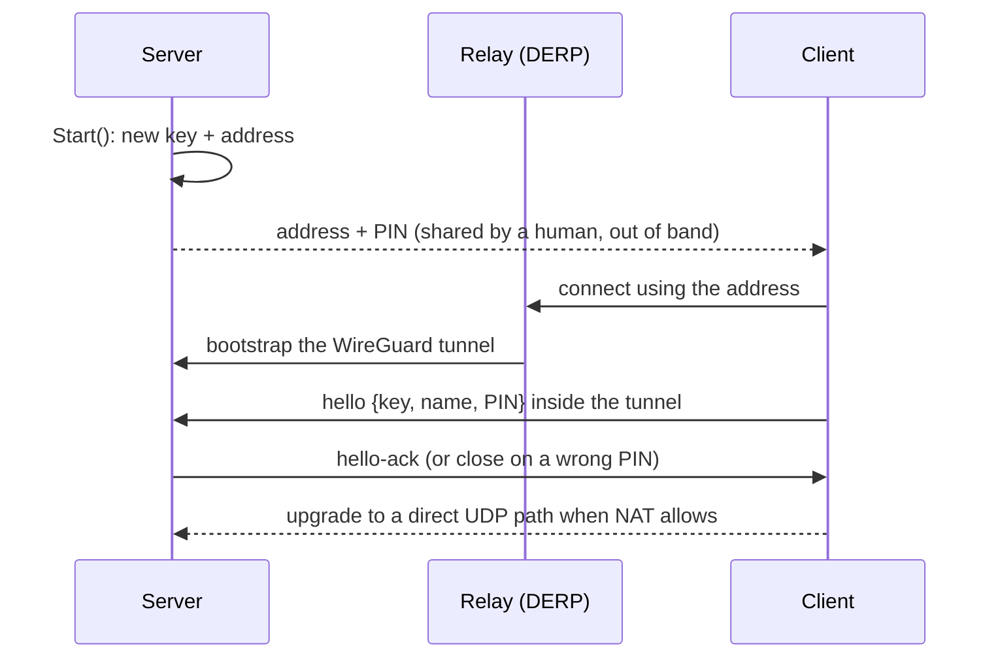

# MESHnet

**An open protocol for peer-to-peer, end-to-end encrypted connections between devices. No accounts, no control plane, a fresh session every time.**

[](https://pkg.go.dev/github.com/BARGHEST-ngo/MESHnet)
[](LICENSE)


[Go docs](https://pkg.go.dev/github.com/BARGHEST-ngo/MESHnet) · [Android AAR](https://github.com/BARGHEST-ngo/MESHnet/releases) · [Built on MESHnet](#built-on-meshnet)

> **Pre-alpha.** The API and wire protocol will change. MESHnet has not had an independent security audit.

## What is MESHnet?

MESHnet lets one device reach another with an **address** and a **6-digit PIN**. Share both with the other side, and MESHnet finds the best path between the two devices, wherever they are, and keeps it encrypted end to end.

There is no account to create, no key list to manage, and no coordination server that decides who connects. The two devices pair directly, and the session lasts only as long as the connection.

### Peer-to-peer

MESHnet tries for a direct connection first and punches through NAT when it needs to. If that fails, it falls back to a relay. Neither side needs to open a port or change router settings.

### End-to-end encrypted

All traffic travels inside a WireGuard tunnel between the two devices. Relays forward encrypted packets and cannot read them.

### No control plane

Tailscale and similar tools use a coordination server to hand out keys and decide who joins. MESHnet has none. The server's address carries its public key, the PIN is checked by the server itself, and no third party ever holds your keys or your list of peers.

The one shared piece is the relay network. By default MESHnet uses tailcat's public DERP relays, which carry encrypted traffic but can see connection metadata. See [Security model](#security-model).

### Ephemeral

The server makes a new key pair and address on every start. A PIN works once and expires after 10 minutes. When a connection ends, the session is over, and reconnecting requires a new PIN.

## Build on it

MESHnet gives you three building blocks. Your app defines what they carry.

| Primitive | What it is | Use it for |
| --- | --- | --- |
| **Messages** | `{Topic, Data}` frames in both directions | Commands, status, chat, control |
| **Streams** | Raw `net.Conn` pipes, requested by name | Bulk transfer, proxying a local service such as `adb` |
| **Forwarding** | The client's TCP and UDP traffic leaves through the server | A trusted exit on hostile networks |

Topics and stream names act like application protocols on top of MESHnet. MESHdrop, for example, builds file transfer on these primitives.

## Built on MESHnet

<a href="https://github.com/BARGHEST-ngo/MESHdrop">
  <picture>
    <source media="(prefers-color-scheme: dark)" srcset="assets/meshdrop-dark.png">
    
  </picture>
</a>

**[MESHdrop](https://github.com/BARGHEST-ngo/MESHdrop)** sends a file straight from one desktop to another. No cloud, no account, no trace.

**[MESHforensics](https://github.com/BARGHEST-ngo/MESHforensics)** is an encrypted mesh VPN for remote mobile forensics. MESHnet integration is in progress.

Building something on MESHnet? Open an issue and we'll list it here.

## Try it

On one machine:

```console
$ go run ./examples/server
2026/11/04 13:30:01 server address: tcomFwWCCcjS5nKNqAod034nWoJZ...
2026/11/04 13:30:01 server pairing PIN: 482913
```

On the other, anywhere in the world:

```console
$ go run ./examples/client -addr 'tcomFwWCCcjS5nKNqAod034nWoJZ...' -pin 482913
```

The two are now connected over an encrypted tunnel. Add `-v` to either side for verbose logs.

## How it compares

MESHnet uses WireGuard and Tailscale's NAT traversal underneath. What it changes is everything around them: how peers find each other, who decides who connects, and how long anything lasts.

| | WireGuard | Tailscale | MESHnet |
| --- | --- | --- | --- |
| Account or identity provider | No | Yes | No |
| Coordination server | No | Yes, Tailscale's or self-hosted (Headscale) | No |
| Key exchange | Manual, by config file | Handled by the coordination server | Built into the address, plus a one-time PIN |
| Works behind NAT on both sides | No, one peer must be reachable | Yes | Yes |
| Relay fallback | No | Yes (DERP) | Yes (DERP) |
| Identity | Long-lived keys | Long-lived nodes | New keys every session |
| Typical setup | Kernel module or TUN device, usually root | System VPN app, or `tsnet` in your app | A library in your app |

**Compared with WireGuard:** MESHnet is WireGuard without the config. No keys to copy, no endpoints to configure, no ports to forward.

**Compared with Tailscale:** MESHnet leaves out the control plane. No accounts, no persistent node identity, and nothing that decides on your behalf which devices can join.

**Compared with [iroh](https://github.com/n0-computer/iroh):** both dial a peer by its key, hole-punch, and fall back to relays. MESHnet adds a PIN-gated pairing step, single-use sessions, and built-in traffic forwarding, and it ships for Go and Android.

### When to use something else

- **Tailscale** if you want a long-lived network of your own devices with access controls and SSO.
- **Plain WireGuard** for a fixed site-to-site link between machines you control.
- **iroh** if you're building in Rust, or need many peers and a content-addressed data layer.

MESHnet fits when two parties need to connect once, quickly, with no prior setup and no long-lived identity.

## Use cases

**Remote mobile forensics.** An analyst needs to examine a phone held by someone in another country. The phone joins with a PIN, and the analyst reaches its `adb` service over a MESHnet stream, without either side changing router settings.

**Private file transfer.** Send sensitive files directly to one trusted person instead of uploading them to a cloud service first. This is what MESHdrop does.

**Trusted exit on untrusted Wi-Fi.** On hotel or conference Wi-Fi, route a phone's traffic out through a machine you control, so the local network sees only an encrypted tunnel.

Other fits: remote support for a colleague's device, a short-lived private message channel between two people, and field devices that check in and take commands with no inbound ports open.

## The protocol

MESHnet is a small session protocol that runs over TCP inside the WireGuard tunnel, carried by [tailcat](https://github.com/tailscale/tailcat). Tailcat provides Tailscale's data plane (WireGuard, NAT traversal and DERP relays) without Tailscale's control plane.



- **Port 1, control channel:** length-prefixed frames carrying `hello`, `hello-ack`, `msg`, `ping`/`pong`, `close` and `stream-request`.
- **Port 2, streams:** the client dials back with a stream ID, and the connection becomes a raw pipe.
- **Admission:** the server checks the PIN in constant time and checks that the key claimed in `hello` matches the tunnel's WireGuard peer.

The wire format is version 1 and unstable. This repository is the reference implementation, and the format is defined in [`internal/protocol`](internal/protocol).

## Security model

**What MESHnet protects**

- Traffic contents, from the network and from relays. Everything is WireGuard-encrypted between the two endpoints.
- Access to the server. A client needs both the address and a valid, unexpired PIN.
- Against guessing. Three wrong PINs cancel the pairing. Ten failed pairings in one server run lock pairing until the server restarts.

**What it does not protect**

- **Your IP address and metadata.** By default, connections bootstrap through tailcat's public DERP relays ([tailcat.dev/derpmap.json](https://tailcat.dev/derpmap.json)). A relay can see which IP addresses connected, when, and roughly how much data was sent. In a direct connection, each peer sees the other's IP address. MESHnet is not an anonymity tool.
- **A leaked address.** The address is the real secret. The PIN is an access check inside an already-encrypted tunnel, not a password-authenticated key exchange. Anyone holding both the address and the PIN while the pairing is open can join. Treat the address like a password.
- **A compromised endpoint.** If either device is compromised, so is the session.

## Install

Requires Go 1.27.1 or later.

```sh
go get github.com/BARGHEST-ngo/MESHnet
```

**Android:** a prebuilt client AAR (package `meshnetmobile`, client side only) is attached to each [release](https://github.com/BARGHEST-ngo/MESHnet/releases). To build it yourself, run `scripts/build-aar.sh` with `ANDROID_HOME` set.

## Usage

### Server

```go
srv := meshnet.NewServer(meshnet.ServerConfig{
	OnMessage: func(clientID string, m meshnet.Message) {
		log.Printf("%s: %s %q", clientID, m.Topic, m.Data)
	},
	OnClientConnected: func(c meshnet.ClientInfo) {
		log.Printf("connected: %s (%s)", c.ID, c.Name)
	},
})

addr, err := srv.Start()
if err != nil {
	log.Fatal(err)
}

pin, err := srv.NewPairing()
if err != nil {
	log.Fatal(err)
}

log.Printf("address: %s PIN: %s", addr, pin)
<-srv.Done()
```

> **Note:** A server currently accepts one client at a time. `NewPairing` returns `ErrServerFull` while a client is connected. Support for multiple clients is planned.

### Client

```go
c := meshnet.NewClient(meshnet.ClientConfig{
	ServerAddr: addr,
	PairingPIN: pin,
	Name:       "my device",
	OnMessage: func(m meshnet.Message) {
		log.Printf("received: %s %q", m.Topic, m.Data)
	},
	OnStreamRequest: func(target string, stream net.Conn) {
		defer stream.Close()
		// Handle the stream, or return to refuse it.
	},
})

ctx, cancel := context.WithTimeout(context.Background(), 30*time.Second)
defer cancel()
if err := c.Connect(ctx); err != nil {
	log.Fatal(err)
}
defer c.Disconnect()

c.Send(meshnet.Message{Topic: "greeting", Data: []byte("hello")})
```

### Streams

The server can ask the client for a raw `net.Conn`, for bulk transfer or for proxying a local service such as `adb`:

```go
stream, err := srv.RequestStream(ctx, clientID, "adb")
```

The client receives `target` in `OnStreamRequest` and decides whether to serve it.

### Forwarding

Forwarding lets a client send its TCP and UDP traffic out through the server's network. It is off on the server by default, and off for each client until the app turns it on.

```go
srv := meshnet.NewServer(meshnet.ServerConfig{
	Forward: true,
	// ...
})

// After a client connects:
srv.SetForwarding(clientID, true)

// On the client:
conn, err := c.DialTCP(ctx, netip.MustParseAddrPort("93.184.215.14:443"))
pc, err := c.DialUDP(ctx, netip.MustParseAddrPort("9.9.9.9:53"))
```

## Status and limits

- Pre-alpha: expect breaking changes to the API and the protocol.
- One client per server at a time.
- PINs last 10 minutes and are single-use.
- No option yet to use your own DERP relays.
- No independent security audit yet.

## Credits and license

MESHnet is built by [BARGHEST](https://barghest.asia) on top of [tailcat](https://github.com/tailscale/tailcat) by Tailscale.

Licensed under the [GNU Affero General Public License v3.0 or later](LICENSE). If you distribute software built on MESHnet, or run a modified version as a network service, you must make its source available under the same license.
